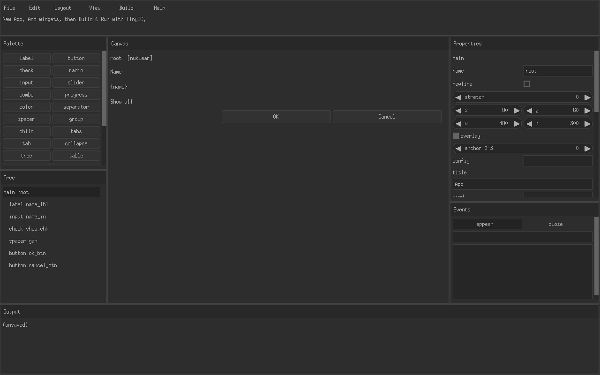
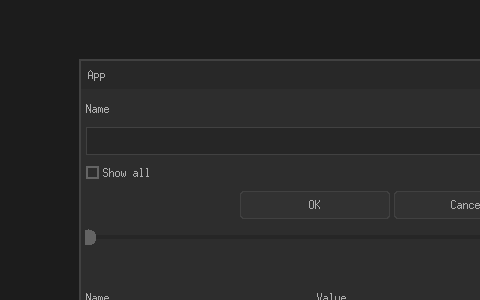

# TCCRAD

**0.1.0-alpha.1.** A rapid-application designer for C. It is the same kind of tool as [ImRAD](https://github.com/tpecholt/imrad): you lay out a window, bind fields, keep your own code in marked regions, and the generated source stays editable. The language is C. The compiler for the programs you design is [TinyCC](https://bellard.org/tcc/). The widget sets are [Nuklear](https://github.com/Immediate-Mode-UI/Nuklear), [libui](https://github.com/andlabs/libui), and [LVGL](https://lvgl.io/) 9.

The designer itself is a Nuklear program on X11. Its text is DejaVu Sans through Xft, so the display-size control stays an outline font. It builds with gcc or with `tcc`. This release is alpha. The version is in `VERSION`. A Nuklear program it generates uses the same outline font, at 16 pixels times the form scale. Spaced C, from the View menu or the event editor, stores handler bodies in the offside dialect: a trailing colon and an indent stand in for braces. The build runs the `offside` command (`TCCRAD_OFFSIDE`, else `../offside/bin/offside`, else `offside` on `PATH`) and compiles the host C it writes. Semicolons stay.

Linux x86_64 builds are published on each push. A version tag `v*` also attaches the single executable `TCCRAD` to a GitHub release. That file is the program, not an archive. It links libX11 and libm, which a normal Linux desktop already has.





## Sample

`examples/bench.c` is a desk you can open with File, Open. It is sized to exercise the designer: menus, four tabs, two-way fields (including a password, a slider, a combo, radios, and a color), a progress bar bound to the gain, a readings table, a tree, a splitter, a child meter, an overlay status line, a popup, and an About modal. File, New run and Reset clear the counters. View, Tip opens the popup. Help, About opens the modal. Run pass counts only while Armed is checked. Edits climb on change, toggle, and table select. A draw-pre region rewrites the status line every frame, and a fields region adds `scratch`, which draw-post increments. Compact and night each hide one notes label until that configuration is active. Sizes are dialog units at scale 1000. The matching header is `examples/bench.h`.

## What you can design

- Window kinds: floating window, OS main window, popup, modal, and a fullscreen activity.
- Widgets: label, button, checkbox, radio, text input, slider, combo, progress, color, separator, spacer, group, child, tabs, collapsing section, tree, table, splitter, dock, menu bar, menu, menu item, image, and a custom callback.
- Rows instead of absolute placement. A widget can start a row, share the previous row, or take stretch weight. A negative width or height is a gap from the far edge (`tr_remain` on Nuklear). Overlay widgets keep a distance from a chosen corner of the parent.
- One-way bindings (`count + 1`, `name`) and two-way bindings that name an `int` or `char[N]` field. Field names in an expression are rewritten to `ui->field`.
- Events (`click`, `change`, `toggle`, `appear`, `close`, `select`, `draw`) with handler bodies stored in `/* @tccrad user ... */` regions. Regeneration leaves those bodies alone.
- A struct wizard for the fields the form reads and writes.
- Named configurations (phone, compact, …). A widget with a config name is emitted inside `tr_cfg_on`.
- A style file of the 32 Nuklear colors, applied to generated Nuklear programs and to the LVGL screen background.
- Dialog units: pixels, or dp scaled by `scale_milli` (1000 means 1.0) through `tr_unit`.
- Build and run. The designer writes `out/app.c`, `out/main.c`, and `out/app.h`, then runs `tcc` with `posix_spawn` (argument array, no shell).

Limits, on purpose: 128 widgets, 48 fields, 8 configurations, user regions up to 32 KiB. Tables without child widgets call `Class_cell`. libui has no splitter or color wheel, so a splitter is a horizontal box and a color is a 0–255 spin box. LVGL radios are dropdowns. Images are a path string; Nuklear shows that path as a label, LVGL passes it to `lv_image_set_src`.

## Build

```sh
sudo apt install build-essential libx11-dev tcc
make
make test
make tcc          # the designer, compiled by tcc
./build/TCCRAD
```

`make test` checks the document round-trip, compiles a generated Nuklear program with gcc and tcc, and typechecks the libui and LVGL output against stubs in `tests/stubs/`. A libui build compiles `third_party/libui`, an X11 implementation of the `ui.h` calls tccrad emits, and links `-lX11`. An LVGL build compiles the vendored LVGL 9.4 sources in `third_party/lvgl` into `third_party/lvgl-cache` and reuses those objects (X11 window, `-lX11 -lpthread -lm`). The window keeps the desktop pointer, and a resize keeps the pixels that are still on screen instead of clearing the frame. `TCCRAD_LVGL` can point at another directory that contains `lvgl.h` and `src/`.

`TCCRAD_HOME` overrides the directory used to find `runtime/`, `third_party/`, and `style/`. Otherwise the designer uses the directory that contains the executable, or its parent when the executable lives in `build/`.

## Using it

File, Edit, Layout, View, Build, Help are in the top bar. The palette adds a widget under the selection (or under the nearest container that can hold it). The tree and the canvas both select. Properties and events are on the right. Negative `w` or `h` is the gap from the right or bottom edge.

View opens the struct wizard, configurations, the style editor, Code, and Explore. Design, Code, and Explore are three views. Code and Explore hide the palette, the tree, and the property panes. Design brings them back. F12 switches Design and Code. F4 opens Explore. A double-click on a canvas widget, or on its row in the tree, opens Code at that widget's handler: click, then change, toggle, select, or draw. The procedure list at the top of Code jumps to the function you pick, and the line gutter draws a bar for each brace block the line sits in. Find next jumps to a match. The dropdown shows the routine that contains the first visible line, and `(declarations)` is the text above the first routine. Explore lists the form, its widgets, and those routines. A click shows the detail. Clicking the same row again, or Open, shows a widget on the form or opens a routine at its line. F4 opens Explore. Build writes `out/` next to the saved file (or `/tmp/tccrad-<pid>` when the document has no path) and can start the program. Ctrl+S saves, Ctrl+O opens, Ctrl+Z / Ctrl+Y undo and redo, Ctrl+B builds and runs, Delete removes the selection when a text field is not active.

The − and + on the menu bar change how large the designer is drawn, from 100% to 300%, in steps of 25. View has the same two commands. Ctrl+Minus and Ctrl+Plus do it from the keyboard, and Ctrl+0 returns to 100%. The choice is saved under the user config directory (`$XDG_CONFIG_HOME/tccrad/ui_scale`, or `~/.config/tccrad/ui_scale`). A desktop taller than 1080 pixels, or an Xft DPI above 96, starts above 100% so the text is not a 13px bitmap. That percentage sizes only the designer. A form keeps its own pixels or dialog units.

Save produces a `.c` file whose `/* @tccrad-doc */` block is the widget tree, plus a matching `.h`. Edit only inside `@tccrad user` regions if you want the designer to keep your text. On reload, those regions win over the copy stored in the document block. If the file changes on disk and you have no local edits, it reloads.

A field is `int`, `unsigned`, `float`, `double`, or `char[N]` with `1 <= N <= 4096`. Two-way text bindings have to name a `char[N]` field. The generated struct also has `<field>_len` for each character array.

## CERT C

The designer and the runtime header follow the CERT C rules that apply to this kind of program, as far as a C11 codebase can without a certified toolchain:

- Strings are copied with an explicit capacity (`tr_copy_cap`, `snprintf`, `tr_copy`). `strcpy`, `strcat`, `sprintf`, and `gets` are not used.
- Allocation sizes are checked for wrap before `malloc` / `realloc`. `NULL` from `malloc` is returned to the caller.
- File reads are capped (1 MiB for a document), reject an embedded NUL, and check `fread` / `ferror`. Writes go to a temporary file and then `rename`.
- Style files are a single path component (`[A-Za-z0-9_-]`) opened with `openat` and `O_NOFOLLOW`.
- The compiler and the generated program are started with `posix_spawnp` and an argv array. Tokens that contain shell metacharacters are rejected. `system` and `popen` are not used.
- Widget counts, row loops, and text regions have fixed ceilings. Integer conversions used for sizes are range-checked.
- Format strings in the designer are literals. Names and binding text are passed as `%s` data.
- The core sources build with `-Wall -Wextra -Wconversion -Werror` and `_FORTIFY_SOURCE=2`.

The Nuklear X11 backend is third-party code. It is compiled without `-Wconversion` because those warnings are in that backend, not in tccrad.

## Layout of the tree

```
src/            designer
runtime/tccrad.h
third_party/    Nuklear, its X11 backend, LVGL 9.4, and the libui stand-in
docs/           screenshots for this page
examples/       bench.c, a form you can open and build
style/          color tables
tests/          round-trip test and libui/LVGL stubs
```

Generated programs include `tccrad.h` and, for Nuklear, `nuklear.h`. They do not link a tccrad library.
